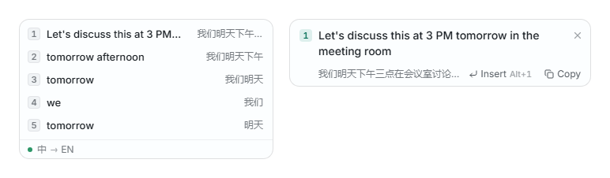
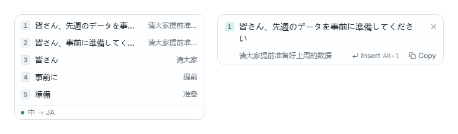
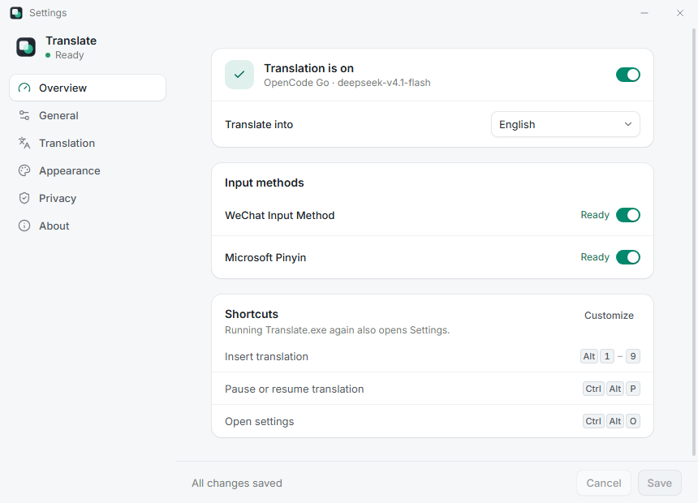
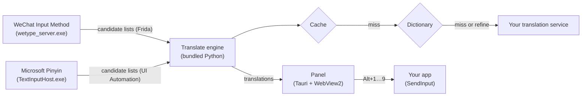

<div align="center">

**English** · [简体中文](README.zh-CN.md) · [日本語](README.ja.md) · [한국어](README.ko.md)


# Translate

**Live translations for WeChat Input Method (微信输入法) and Microsoft Pinyin (微软拼音).**<br>
See what every candidate means while you type pinyin, and insert the translation instead of the Chinese.

[](https://github.com/Rickywu05/translate/releases/latest)
[](https://github.com/Rickywu05/translate/releases)
[](#requirements)
[](LICENSE)

[**Download**](https://github.com/Rickywu05/translate/releases/latest) ·
[Quick start](#quick-start) ·
[Features](#features) ·
[Privacy](#privacy) ·
[FAQ](#faq)

<br>

<picture>
  <source media="(prefers-color-scheme: dark)" srcset="screenshots/readme/hero-en-dark.png">
  
</picture>

</div>

<br>

Translate is a small, quiet companion for **WeChat Input Method (WeType)** and **Microsoft Pinyin** on Windows. As you
type pinyin, a panel
under the candidate window shows the translation of each candidate. Press **Alt+1…9** to type the translation into
whatever app you're using — a chat, an email, a document — without leaving the keyboard.

## Features

| | |
|---|---|
| **Instant for common words** | A built-in dictionary answers single words immediately, offline. |
| **Fast for sentences** | Phrases and sentences come from the translation service you choose — one batched request per list, usually about 1.5 s — and repeats come from the cache. |
| **Insert or copy** | Alt+1…9 types the translation in place of the pinyin; Alt+Shift+1…9 copies it. Your app never loses focus. |
| **Full text for long candidates** | A preview opens beside the panel when candidate 1 doesn't fit; Alt+\` shows it on request. |
| **Seven target languages** | English, Japanese, Korean, French, German, Spanish and Russian. |
| **Bring your own service** | OpenAI, Claude, Gemini, Grok, DeepSeek, OpenCode Go, or any OpenAI-, Claude- or Gemini-compatible endpoint. |
| **Stays out of the way** | No window and no tray icon. The panel appears only while you compose, skips password fields it can detect, and starts with Windows. |
| **Private by design** | Keys stay in Windows Credential Manager. Text goes only to the service you pick. Logs never contain what you type. |
| **At home on Windows** | Interface in English, 简体中文, 日本語 and 한국어; light and dark themes that follow the system. |

<div align="center">
<picture>
  <source media="(prefers-color-scheme: dark)" srcset="screenshots/readme/hero-ja-dark.png">
  
</picture>
</div>

## Quick start

1. **Download** `Translate-<version>-win-x64.zip` from
   [Releases](https://github.com/Rickywu05/translate/releases/latest).
2. **Unzip** it anywhere, for example `%LOCALAPPDATA%\Programs\Translate`.
3. **Run** `Translate.exe`. No installer, admin rights, Python or other tools are needed.

Translate runs in the background — nothing appears until you type pinyin with WeChat Input Method or Microsoft Pinyin in
any app. From then
on it starts with Windows (turn that off in Settings › General).

> [!TIP]
> Without a translation service, single words are still translated into English by the built-in dictionary.
> Add a service for phrases, sentences and the other languages.

**Connect a translation service.** Run `Translate.exe` again (or press **Ctrl+Alt+O**) to open Settings, then:

1. **Translation › Service** — pick a provider. The endpoint and a default model are filled in; **Load models** lists
   what your key can use.
2. Paste your **API key**, press **Test connection**, then **Save**. The key goes to Windows Credential Manager and is
   never shown again.
3. **Overview › Translate into** — choose your language.

<div align="center">
<picture>
  <source media="(prefers-color-scheme: dark)" srcset="screenshots/readme/settings-overview-dark.png">
  
</picture>
</div>

<details>
<summary><b>Supported services</b></summary>

<br>

| Service | API format | Authentication |
|---|---|---|
| OpenAI | Chat Completions | API key |
| Claude (Anthropic) | Messages | API key |
| Gemini (Google) | Gemini API | API key |
| Grok (xAI) | OpenAI-compatible | API key |
| DeepSeek | OpenAI-compatible | API key |
| OpenCode Go | OpenAI-compatible, routed per model | Plan API key |
| Custom | OpenAI-, Claude- or Gemini-compatible | Bearer token, `x-api-key`, custom header, query parameter or none |

Every service has a configurable endpoint, model and timeout. Use a service whose terms allow this kind of use; some
plan-based subscriptions (OpenCode Go, for example) are intended for coding tools only.

</details>

## Keyboard shortcuts

| Keys | Action |
|---|---|
| <kbd>Alt</kbd>+<kbd>1</kbd> … <kbd>9</kbd> | Insert that candidate's translation |
| <kbd>Alt</kbd>+<kbd>Shift</kbd>+<kbd>1</kbd> … <kbd>9</kbd> | Copy it instead |
| <kbd>Alt</kbd>+<kbd>&#96;</kbd> | Show or hide the full text |
| <kbd>Alt</kbd>+<kbd>↑</kbd> / <kbd>↓</kbd> | Preview another candidate |
| <kbd>Alt</kbd>+<kbd>PgUp</kbd> / <kbd>PgDn</kbd> | Scroll the full text |
| <kbd>Alt</kbd>+<kbd>0</kbd> | Hide or show the panel |
| <kbd>Ctrl</kbd>+<kbd>Alt</kbd>+<kbd>P</kbd> | Pause or resume translating |
| <kbd>Ctrl</kbd>+<kbd>Alt</kbd>+<kbd>O</kbd> | Open Settings |

Right-click a row to insert, copy or retry it. To use the mouse, turn on **Settings › Appearance › Keep the panel
clickable** — WeType's candidate window takes all clicks right under the candidates, so this moves the panel clear of it.

Pause, Open Settings and Hide or show the panel can be changed in **Settings › General** (Translate checks that no other
app holds the new keys). **Settings › Overview** lists WeChat Input Method and Microsoft Pinyin, whether each is ready,
and a switch to turn either off; with both on, Translate follows whichever one you type with.

## Privacy

- **Read locally:** the input method's candidate list (WeType: its own messages; Microsoft Pinyin: Windows' accessibility
  interface), the candidate window's position, the caret, and the foreground app's name
  (to skip detectable password fields and excluded apps).
- **Sent:** uncached candidate texts and the target language — only to the translation service you chose, and nothing
  in **Local only** mode or without a service. Nothing goes to the authors of Translate: no account, telemetry or
  update check.
- **Stored:** settings (no key), keys in Windows Credential Manager, short dictionary words in an encrypted cache, and a
  size-capped log without candidate text or translations.

Full details: [docs/privacy.md](docs/privacy.md).

## Requirements

| | |
|---|---|
| **Windows** | 10 or 11, x64 |
| **Input method** | [WeChat Input Method](https://z.weixin.qq.com/) (tested with **3.0.0.34**) and/or **Microsoft Pinyin** (Windows 11; tested on build 26200) |
| **Translation service** | Optional — your own API key, for phrases, sentences and languages other than English |
| **Disk space** | About 61 MB download, 156 MB unpacked |
| **WebView2** | The Microsoft Edge WebView2 Runtime, built into Windows 11 and current Windows 10 (Translate tells you if it's missing) |

## Known limitations

- **WeType updates.** Translate reads WeType's internal messages, which aren't a public interface. A WeType update can
  stop it from seeing candidates until Translate is updated — please
  [open an issue](https://github.com/Rickywu05/translate/issues) with your WeType version.
- **Security software** may flag Translate, because it attaches to WeType's process (with Frida) to read candidates.
  Microsoft Pinyin needs no such attachment.
- **Microsoft Pinyin on Windows 10**, and its *use previous version* setting, are untested.
- **Not code-signed** yet, so SmartScreen warns on first launch.
- **Placement** follows WeType's bar wherever it is drawn (any layout, display scaling or screen edge). Mixed
  scaling across several monitors and Windows on ARM are untested.
- **Portable only:** no installer or Start menu entry. If you move the folder, run `Translate.exe` once from the new
  place so Start with Windows follows it.
- The built-in dictionary covers Chinese → English only.

## FAQ

<details>
<summary><b>Windows says "Windows protected your PC". Is it safe?</b></summary>

<br>

Translate isn't code-signed yet, so SmartScreen doesn't recognise it. Choose **More info › Run anyway**. You can check
the download against `SHA256SUMS.txt` from the same release:

```powershell
Get-FileHash .\Translate-0.2.3-win-x64.zip -Algorithm SHA256
```

</details>

<details>
<summary><b>Nothing happened when I started it.</b></summary>

<br>

That's expected: Translate has no window or tray icon. Type pinyin with WeChat Input Method or Microsoft Pinyin and the panel appears under
the candidates. Run `Translate.exe` again or press <kbd>Ctrl</kbd>+<kbd>Alt</kbd>+<kbd>O</kbd> to open Settings.

</details>

<details>
<summary><b>Do I need an API key?</b></summary>

<br>

No. Without one, single words are translated into English by the built-in CC-CEDICT dictionary. A service adds
phrases, sentences and the other six languages.

</details>

<details>
<summary><b>How do I pause or quit it?</b></summary>

<br>

<kbd>Ctrl</kbd>+<kbd>Alt</kbd>+<kbd>P</kbd> pauses and resumes. To quit, open Settings and choose **About › Quit
Translate**.

</details>

<details>
<summary><b>How do I uninstall it?</b></summary>

<br>

Turn off **Settings › General › Start with Windows** and press Save, then quit Translate. Delete its folder and
`%APPDATA%\Translate`. Remove saved keys in Windows Credential Manager › Windows Credentials (entries starting with
`Translate:service:`).

</details>

## How it works



The engine attaches to WeType's `wetype_server.exe` with Frida, decodes the candidate lists WeType sends to its own
candidate window, and tracks that window's position. For Microsoft Pinyin it reads the candidate window through UI
Automation (the accessibility interface Narrator uses) — no attachment at all. Each list goes through the cache, the dictionary and then one
batched request to your service. Inserting cancels the pinyin composition and types the translation with `SendInput`,
without taking focus from your app.

More: [Development guide](docs/development.md) · [Design system](DESIGN.md) ·
[Engine protocol](docs/protocol.md) · [Release build](docs/release.md) · [Changelog](CHANGELOG.md)

## Build from source

Requires Windows 10/11 x64, Node 22+, Python 3.12, Rust (MSVC, with the Visual Studio Build Tools) and Frida 17.23.3
vendored into `backend/vendor`:

```powershell
python -m pip install --target backend/vendor frida==17.23.3
cd app
npm install
python -X utf8 scripts/package.py
```

See [docs/development.md](docs/development.md) for tests and the portable release build.

## Feedback

Found a bug, or does your WeType version not work? [Open an issue](https://github.com/Rickywu05/translate/issues)
with your Windows and WeType versions. The log (Settings › Privacy › Open logs) holds states, counts and timings, never
candidate text or translations.

## License

[MIT](LICENSE) © 2026 Rickywu05

The local dictionary is derived from [CC-CEDICT](https://www.mdbg.net/chinese/dictionary?page=cedict) (CC BY-SA 4.0).
Release downloads bundle Python, Frida, Tauri and other components under their own licenses — see
[THIRD_PARTY_NOTICES.txt](app/build/THIRD_PARTY_NOTICES.txt).

<br>

<div align="center"><sub>Translate is an independent project. It is not made by, affiliated with or endorsed by Tencent or WeChat.</sub></div>
