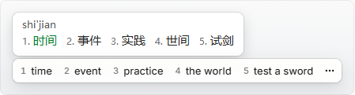
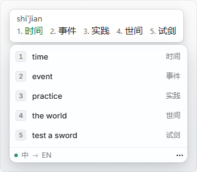

# Stage 1 — research and two design directions

## Run it

```
cd prototype
npm install        # first time only; npm cache stays in ../.cache
npm run dev        # → http://localhost:5320
```

The top bar switches **direction (A/B)**, **view**, **interface language**, **target language** and
**theme**. The URL keeps the state (`?dir=b&view=settings&page=privacy&lang=ja&theme=dark`), so any view can be
linked or reopened.

| View | What to look at |
|---|---|
| Desktop | Simulated Windows desktop. Click the message field and type letters (or press a scenario button). Hold Alt, press Alt+1…9, Alt+0, Ctrl+Alt+P, Ctrl+Alt+O. Hover bar items. The right panel simulates relaunching the exe, notifications, light/dark apps and the screen-edge placement. |
| Bar states | Every bar state at 100% scale on light and dark apps, under a mock WeChat candidate window. |
| Settings | The settings window on its own (all pages). |
| Components | Typography (four scripts), color tokens, buttons × states, inputs, toggles, messages, menus, nav states. |

## Reference findings

Full notes: [research/linear-notes.md](research/linear-notes.md). In short: the bar takes Linear's
*“don't compete for attention you haven't earned”* and *“structure felt, not seen”* principles literally.
Both themes are built in OKLCH with even lightness steps. The type is a single family (Inter) with
script-correct Windows CJK fallbacks. Settings are treated as a place to learn the product, which matters
here because there is no tray icon. Limitation: I couldn't inspect Linear's live settings screens (no
workspace), only the article images.

## The two directions

Both use identical data, states, copy, settings structure and save model. They differ in layout,
density, hierarchy, neutral temperature and accent.

### A · Ribbon — “a continuation of the candidate row”



- **Bar**: one horizontal line under the IME window, in the same reading order as the candidates above
  it. A muted number plus the translation, nothing else. The original, source and full text are in a
  hover peek. Status appears only when something is abnormal, as a short chip at the end.
- **Settings**: Linear-like. Recessed sidebar, dense 44 px rows in hairline groups, and a floating save
  bar that only appears when there are unsaved changes.
- **Look**: warm graphite neutrals, cobalt accent, tight radii (5–8 px), 28 px controls.
- **Strengths**: smallest footprint (30 px tall), and the eye moves straight down from candidate N to
  translation N. It's least distracting while typing fast.
- **Costs**: width depends on content, so the bar can widen or narrow a little as results arrive.
  Loading placeholders are sized by estimate to keep this small, but it's inherent. Long phrases
  truncate at 200 px, so the full text needs a hover. With 7–9 candidates and a long target language,
  the bar can get wide (it slides left at screen edges).

### B · Panel — “a small reference card”



- **Bar**: a fixed-width vertical list with a key chip, the translation, and the original right-aligned
  on every row. A fixed footer shows the language pair, or the status when degraded, plus the ⋯ menu.
  The full text opens in a side peek.
- **Settings**: an Overview home page (status, pause, setup checklist, how to reach the app without a
  tray). Card sections, 52 px rows, and a persistent Save/Cancel footer.
- **Look**: cool porcelain neutrals, jade accent, softer radii (6–12 px), 32 px controls.
- **Strengths**: no layout shift at all, since rows, width and footer are fixed. You always see which
  Chinese candidate a translation belongs to. Status is always findable. Easiest to learn, especially
  on first use.
- **Costs**: about 4× the area of A (300 × ~200 px vs ~470 × 30 px). It covers more of the app underneath and draws more
  attention during continuous typing. The vertical order doesn't match the IME's horizontal row, so the
  eye has to re-map 1–5.

### Hybrids worth considering

The directions are separable on three axes:

1. **Bar shape**: horizontal or vertical.
2. **Status**: on demand or always present.
3. **Settings shell**: A's dense layout with a floating save bar, or B's Overview page with a persistent
   footer.

A common hybrid is A's bar with B's settings (Overview helps with the tray-free model).

## Tray-free interaction model (proposal)

| Need | How |
|---|---|
| Open settings | Launch Translate again (Start / shortcut). The single-instance lock forwards to the running instance and opens settings. Also **Ctrl+Alt+O**, bar ⋯ → Settings, or the notification button. |
| Pause / resume | **Ctrl+Alt+P**, bar ⋯, or settings sidebar (A) / Overview switch (B). The bar says “Translation paused”, once per composition. |
| Hide bar | **Alt+0** (only while a candidate list is visible) or bar ⋯ |
| Quit | Bar ⋯ → Quit, Settings › About → Quit, optional Jump List task |
| First run | Settings opens on first launch. After you save, one notification: “running in the background — Ctrl+Alt+O”. |
| Needs attention | The bar status, plus one Windows notification per blocking incident (rejected key, unsupported IME version, repeated backend crash) |

The Desktop view simulates all of these: the relaunch button, both notification types, quit and
relaunch, and the shortcuts.

## Screenshots

`screenshots/stage1/`

- `compare/compare-light.png`, `compare/compare-dark.png`: **A vs B side by side for every state** (start here)
- `{a,b}-states-{light,dark}.png`: full state boards
- `{a,b}-desktop-{light,dark}.png`: the simulated desktop mid-typing
- `{a,b}-settings-{general,translation,appearance,privacy}-{light,dark}.png`, `b-settings-overview-light.png`
- `{a,b}-settings-general-{zh-CN,ja,ko}.png`, `{a,b}-states-ja-target.png`: localization
- `{a,b}-components-{light,dark}.png`: component showcase
- `interaction/`: moments captured during the automated run (hover peek, Alt held, unavailable item,
  dirty settings, live language preview, screen edge) plus `results.json`
- `scaling/`: the desktop at 125 / 150 / 200% device scale

Regenerate with `npm run shots`, `node scripts/interact.mjs`, `node scripts/compare.mjs` and
`python scripts/compare_sheet.py`.

## Iteration log (issues found by inspecting renders, then fixed)

| # | Observed | Impact | Change |
|---|---|---|---|
| 1 | Bar labels rendered in Chinese with the English UI selected | Wrong language at first paint | Language is set before first render, then follows the live setting |
| 2 | Mock IME showed broken pinyin (“sh ij ia n”) | Distracting, untrustworthy demo | Pinyin shown with apostrophes, like the real IME |
| 3 | “Failed” wrapped to two lines; four repeated “Failed” labels next to a status saying the same | Noise, broken rhythm | `nowrap`; when the status explains a list-wide failure, items reduce to an icon (A) or neutral text (B) |
| 4 | Dark-theme bar text looked bold; dark bar edge weak on dark apps | Heavier than intended, poor separation | Per-theme bar weight token; lighter dark bar surface; stronger ring |
| 5 | B: long translations cut to “Let's discuss thi…” because the original took 42% | Primary content lost | Original capped at 32% |
| 6 | B footer status strings truncated | Status unreadable | Shorter status copy in all four languages |
| 7 | Settings: infinite render loop (selector returned a new array) | Settings view crashed | Derive the dirty set from stable state |
| 8 | Disabled primary Save looked like a washed-out active button | Ambiguous state | Disabled primary becomes neutral |
| 9 | Live preview in Appearance clipped the bar; ja sidebar label wrapped | Broken layout at real sizes | Preview sized to content, short sample; labels truncate, shortcut never wraps |
| 10 | A: loading placeholders for phrases were wider than results | Visible shrink when results land | Estimate tightened (3–12 ch) |

## Verification record

**Environment**: Windows 11 Pro 10.0.26200, Node 24.18, Vite 7, React 19, headless Microsoft Edge (system
install) driven by playwright-core. Everything in this stage is **simulated in a browser**. None of it
ran on real Electron windows, the real WeChat IME or physical multi-monitor hardware.

Automated interaction run (`scripts/interact.mjs`, both directions): **32 / 32 passed**.

| Check | A | B |
|---|---|---|
| Translations listed in candidate order | ✓ | ✓ |
| Hover opens the full-text peek with source and key | ✓ | ✓ |
| Clicking an item inserts it; **the field keeps focus** (simulated: `mousedown` default prevented) | ✓ | ✓ |
| Composition cleared after insert | ✓ | ✓ |
| Alt+3 inserts translation #3 | ✓ | ✓ |
| Alt+N on a loading item: notice, nothing inserted | ✓ | ✓ |
| Alt+0 hides and shows the bar | ✓ | ✓ |
| Ctrl+Alt+P pauses and resumes | ✓ | ✓ |
| Ctrl+Alt+O opens settings | ✓ | ✓ |
| Unsaved change counted; Cancel reverts a live-previewed setting | ✓ | ✓ |
| Interface language previews live on the same page; Cancel restores it | ✓ | ✓ |
| Saved value survives closing and reopening settings | ✓ | ✓ |
| Near the bottom-right edge, the bar flips above the caret and stays on screen | ✓ | ✓ |
| No runtime errors | ✓ | ✓ |

Visual checks by inspecting renders: four interface languages (zh-CN, en, ja, ko) in settings, with no
clipped labels after fix #9. Japanese and Korean target text in the bar, with the correct script fonts.
Light and dark themes. 125 / 150 / 200% device scale renders crisply, with no layout change since CSS
pixels are constant.

**Not yet tested (real hardware and later stages)**:

- Focus preservation with a real non-activating Electron window over real apps.
- Real WeChat IME candidate-window tracking.
- Per-monitor DPI changes while moving between monitors, negative coordinates, sleep and resume.
- Real Unicode insertion.
- Screen-reader output.
- Keyboard navigation inside settings was spot-checked (focus rings visible) but not fully audited.
- Contrast ratios are computed from token lightness, not measured with a tool.

## What I need from you

1. **Choose a direction**: A, B, or a named hybrid (bar shape / status / settings shell).
2. React to the **shortcut defaults** (Ctrl+Alt+O, Ctrl+Alt+P) and the tray-free model.
3. Anything that looks ugly, unbalanced or generic: point at the screenshot, and I'll trace the cause.
